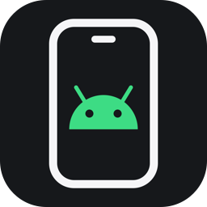

<p align="center">
  
</p>

<h1 align="center">AndroiOS</h1>

<p align="center">Android on iOS, reimagined.</p>

## Disclaimer
**This app can not be published to the App Store.**
This is because:
1. Apple does not natively allow JIT and the developer entitlements used to allow increased memory usage on the App Store.
2. App Store policies state that the app must be closed source, with no public code available for anyone, which this app isn't (GPL-3.0, open source).
   
# Overview
Run Android (LineageOS 23.2 / Android 16) on an iPhone or iPad. AndroiOS is a sideloaded
SwiftUI app that runs an AArch64 VM **in-process** with QEMU's JIT (TCG). Android's
OpenGL ES rendering runs on the **Apple GPU**:

```
Android (HWUI/SurfaceFlinger, GLES) ─► Mesa virgl ─► virtio-gpu ─► QEMU
   ─► virglrenderer ─► libepoxy ─► ANGLE (GLES on Metal) ─► Apple GPU
   ─► IOSurface ─► MTKView
```

The GPU components are the ones **UTM** ships on iOS: `utmapp/virglrenderer`,
`utmapp/libepoxy`, and ANGLE from `utmapp/WebKit` (Safari's ANGLE), all at UTM's pinned
commits. The guest is the prebuilt LineageOS `virtio_arm64only` VM from
[jqssun/android-lineage-qemu](https://github.com/jqssun/android-lineage-qemu), built for
UTM/QEMU: UEFI → GRUB → Android, Mesa virgl, drm_hwcomposer.

> **Emulation, not virtualization.** iOS gives apps no hypervisor, so every guest
> instruction goes through QEMU's JIT. GPU work runs natively on the Apple GPU; CPU-bound
> Android UI does not reach 60 FPS. See [docs/PERFORMANCE.md](docs/PERFORMANCE.md).

## Verified (macOS harness running the iOS engine code)
- LineageOS 23.2 boots to setup in about 3–5 minutes, rendered on the Apple GPU with readable text
- Touch via USB tablet: taps dismiss dialogs and advance the setup wizard
- Audio: AC97 → QEMU `ios` audiodev → app callback
- Boot animation at 40–50 FPS; GPU benchmark (glmark2) 103–130 FPS

## Known Issues
- **Freezes at 0 FPS until you pull down Notification Center; crashes during boot. Fixed in v0.2.1-alpha, awaiting on-device confirmation.**
  Cause: memory. Without the increased-memory-limit entitlement an 8 GB iPhone gives an app ~3.5 GB,
  so iOS sent memory warnings, and AndroiOS **paused** the VM on each one (0 FPS, idle CPU); becoming
  active again resumed it. When memory ran out, iOS killed the app. Now memory warnings shrink
  Android through virtio-balloon (returning memory to iOS) without pausing, the default guest RAM
  is based on what iOS actually allows the app, and the setup screen shows that limit and whether
  the memory entitlement is active. QEMU threads also run at user-interactive QoS, as in UTM.
- **App unresponsive after the LineageOS download. Fixed in v0.2.1-alpha.** Download progress
  callbacks ran on the main thread (tens of thousands for 1.2 GB). They now run in the background
  with progress shown 4 times a second, and the wizard continues automatically when the download ends.
- Dark screen / crash at launch with JIT on iOS 26+: fixed in v0.2.0-alpha. Confirmed on an
  iPhone 16 Pro: LineageOS reaches its boot animation.
- SideStore "The file can't be opened": fixed in v0.2.0-alpha (10 MB IPA, in-app LineageOS download).

## JIT on iOS 26+
On iOS 26 and later, devices with the Trusted Execution Monitor (TXM, A15 and newer) only run code
in regions the attached debugger has prepared. AndroiOS:
1. maps QEMU's 256 MB code buffer read+execute (no `MAP_JIT`, no RW→RX flip);
2. asks StikDebug to prepare it: `x0` = address, `x1` = size, `x16` = 1, `brk #0xf00d`
   (a SIGTRAP handler turns a missing debugger into an error message, not a crash);
3. creates a read-write alias with `vm_remap` for QEMU's split-W^X (`tcg_splitwx_diff`);
4. detaches the debugger (`x16` = 0, `brk #0xf00d`) so QEMU's signals no longer stop the process.

The legacy `brk #0x69` handshake is not used; current `universal.js` rejects it. Devices without
TXM, and iOS versions before 26, only need the debugger-attached flag (`CS_DEBUGGED`). Progress is
logged to Console.app under the subsystems `com.androios.engine` and `com.androios.qemu`.

Tested on a real iPhone (iPhone 16 Pro, iOS 26+): JIT works through StikDebug's universal.js script and LineageOS 23.2 boots on the device.

## Quick start
```sh
git clone --recursive <this repo> && cd AndroiOS
Scripts/build-all.sh          # WebKit ANGLE + engine + app → build/AndroiOS.ipa
Guest/fetch-lineage.sh        # LineageOS 23.2 VM (verified attestation) → Guest/build/lineage/
```
On the device:
1. Sideload `AndroiOS.ipa` (10 MB) from the [releases](https://github.com/alolaxd/AndroiOS/releases).
2. Apply the memory entitlements with GetMoreRAM, TrollStore, or a paid developer profile.
   Without them, AndroiOS lowers guest RAM to what iOS allows the app instead of being killed.
3. Enable JIT with StikDebug using the **universal.js** script.
4. In the setup wizard, download LineageOS 23.2 (~1.2 GB), then boot.

`Scripts/build-ipa.sh --with-guest` can still bundle the disks into a ~1 GB IPA for Xcode or
TrollStore installs; SideStore cannot sign IPAs that large.

## Layout
| Path | What |
|---|---|
| `App/` | SwiftUI app: VM manager, setup wizard, Metal display, touch/keyboard, audio, settings |
| `Engine-C/AndroiOSEngine.{h,m}` | C API: lifecycle, UEFI/disks, display/input/audio callbacks, snapshots, perf |
| `Engine-C/build-angle.sh` | WebKit ANGLE (UTM's pin) → `EGL.framework`, `GLESv2.framework` |
| `Engine-C/build-ios.sh` | glib, pixman, libslirp, UTM libepoxy + virglrenderer, QEMU → `QEMU.framework` |
| `Engine-C/ios-patches/` | QEMU 9.2.4 patches: in-process dylib, iOS JIT, IOSurface display, audio, input |
| `Engine-C/tests/` | macOS harness (`run-engine-harness.sh`) plus GL checks |
| `Guest/fetch-lineage.sh` | Fetches and verifies the LineageOS VM |
| `Guest/build-guest.sh` | Alternative guest: Ubuntu + Waydroid (see docs/BUILDING.md) |

## Important Context
**Almost all of this app's code was made by Claude**. Claude wrote the code, ironed everything out, but the design decisions, ideas, architecture choices, and direction were all mine. I guided the implementation, decided how things should work, and shaped the end result. I'm a student, still learning. Expect to see some of my own updates without Claude 🙂


## License
QEMU is GPL-2.0; the patches and code linked into `QEMU.framework` are GPL-2.0-or-later.
virglrenderer and libepoxy are MIT, ANGLE is BSD-3-Clause, and LineageOS is under its
own licenses. The app icon contains the Android robot, which is reproduced or modified from work
created and shared by Google and used according to terms described in the Creative Commons 3.0
Attribution License.
